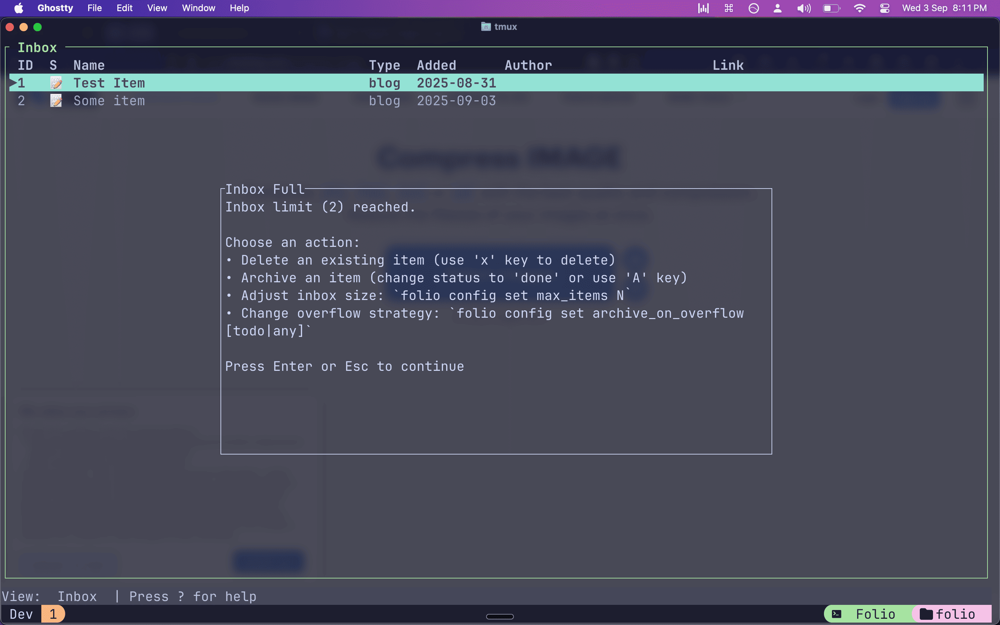

# Folio

*A personal bookmark and link management tool with a "read it or lose it" philosophy*

## Why?

I bookmark/save plenty of articles/blog posts etc and that floods my to read list. Which means when I get to it, it is overwhelming and there is no real way for me to discern what I must read and what is potnetially fluff.

So now, I made a small tool where I can only have a limited number of items in my to read list. Anything more that I want to add? Either read something that or delete something. Simple as. Or of course watch/listen for videos/podcast respectively.

## Screenshot



Hopefully this will also make me deliberate in what I add in the first place.

## Architecture

Folio is a small client-server tool:

- **`folio-server`** has the data (SQLite) and serves a web UI
- **`folio`** (CLI) and the built-in TUI are thin clients that talk to it over HTTP
- **`web/`** is a dependency-free single page app served by the same server

## Install

Clone it and build it. And it is yours. Do as you see fit.

```bash
git clone https://github.com/smitchaudhary/folio.git
cd folio

cargo install --path crates/folio-server
cargo install --path crates/folio-bin
```

## Running the Server

Everything needs a running server first:

```bash
folio-server serve
```

Options:

| Flag | Default | Description |
|------|---------|-------------|
| `--bind` | `127.0.0.1:8787` | Address to listen on |
| `--db` | `~/.folio/folio.db` | Path to the SQLite database |
| `--web-dir` | `web` | Directory containing the web app files |

The web UI is then at `http://127.0.0.1:8787`.

### Pointing Clients at the Server

The CLI and TUI find the server in this order:

1. `FOLIO_SERVER` environment variable (e.g. `FOLIO_SERVER=http://myhost:8787`)
2. `~/.folio/client.json` containing `{"server_url": "http://..."}`
3. Fallback: `http://127.0.0.1:8787`

## How To

It is simple tool and the help section should be self explanatory but a list of basic commands

### Add Your First Item using CLI
```bash
folio add --name "Some title" --type blog_post --link "https://example.com/blog_1"

# Add a video
folio add --name "My fav video" --type video --author "Some dude"

# Add a podcast
... (you get it now)

# Notes work too
folio add --name "Some paper" --type academic_paper --link "https://..." --note "read section 3"

# References are kept forever: kind=reference items are added straight
# to the archive as done
folio add --name "Rust book" --type blog_post --link "https://..." --kind reference

# No --name? Opens an interactive add form in the TUI instead
folio add
```

### View Your Items
```bash
folio list                    # Inbox items (default)
folio list --archive          # Archived items
folio list --all              # All items (inbox + archive)

# List only videos in the current view
folio list --type video

folio list | grep -i rust
```

### Interactive Mode

You can also use the TUI

```bash
folio
```

### Web App

The server also serves a small web UI. No build step, no framework, just open the server URL in a browser.

- Inbox / Archive / All tabs (also hash routes: `#/inbox`, `#/archive`, `#/all`)
- `/` focuses search, `n` opens the add form
- Click the status emoji on any row to change its state
- Edit, delete, toggle reference, and edit config inline
- Dark mode toggle (remembered in localStorage)

No auth. Is only accessible from the tailnet for me, do as you wish ofc.

## Item Types

The items can be of one of these 7 types (including others for a catch-all)

| Type | Description | CLI Usage | Display |
|------|-------------|-----------|---------|
| **Blog Post** | Articles, essays, blog posts | `blog_post` | `blog` |
| **Video** | Videos, talks, lectures | `video` | `vid.` |
| **Podcast** | Audio content, episodes | `podcast` | `pod.` |
| **News** | News articles, breaking news | `news` | `news` |
| **Thread** | Twitter threads, forum discussions | `thread` | `thrd` |
| **Academic Paper** | Research papers, academic content | `academic_paper` | `acad` |
| **Other** | Miscellaneous content | `other` | `oth.` |

## Usage

### Basic Commands

```bash
folio add --name "Title" --type video --link "https://..." --author "Creator"

folio list                    # Inbox items (default)
folio list --archive          # Archived items
folio list --all              # All items (inbox + archive)
folio list --type video       # Filter by type (within the chosen view)
folio list --status todo      # Filter by status

# Update status
folio set-status 1 done            # Mark item #1 as done (moves it to archive)
folio set-status --archive 1 todo  # Restore archived item #1 to the inbox

# Edit items
folio edit 1                       # Edit item #1 interactively
folio edit --archive 1             # Edit archived item #1

# Remove items
folio delete 1                     # Delete item #1
folio delete --archive 1           # Delete archived item #1
folio archive 1                    # Move to archive

# Manage references (archived items only)
folio mark-ref --archive 1         # Mark/unmark archived item #1 as reference

# Config
folio config list             # Show current config
folio config get max_items    # Show one value
folio config set max_items 50 # Set inbox limit
folio config set archive_on_overflow todo  # Auto-archive oldest todo items
folio config reset            # Back to defaults
```

> **IDs** are positions within the current view (inbox by default, archive with `--archive`). Filtered lists show true positions with gaps, so any ID you see in a list works directly in a command.

### Status

Each item has one of three statuses:
- **📝 Todo**: Not started yet
- **⏳ Doing**: Currently working on
- **✅ Done**: Completed (automatically archived)

### Terminal UI

Launch the TUI for a more visual experience:
```bash
folio
```

**TUI Controls:**
- `↑/↓` or `j/k`: Navigate items
- `J/K`: Move selected item down/up within its list
- `PgUp/PgDn`: Jump pages, `Home/End`: Jump to top/bottom
- `Enter`: Open link
- `y`: Copy link to clipboard
- `a`: Add new item
- `e`: Edit selected item
- `t/i/d`: Change status (todo/in progress/done where done asks for confirmation)
- `x`: Delete item (asks for confirmation)
- `r`: Toggle reference status (archive view only)
- `Tab`: Switch between Inbox/Archive
- `/`: Filter items
- `C`: Configuration
- `?`: Help
- `q/Esc`: Quit

## Config

Config lives inside the database (`config` table in `~/.folio/folio.db`) and can be read/written through the `folio config` subcommands shown above.

Defaults: `max_items = 30`, overflow strategy `abort`.

### Overflow Strategies

- **`abort`**: Prevent adding new items (safest)
- **`todo`**: Auto-archive oldest todo items (the lose it of the "read it or lose it thing")
- **`any`**: Auto-archive the oldest item, regardless of status

Notes:
- `max_items` must be between 1 and 1000 and cannot be set below the current inbox size.
- When the inbox is full and the strategy is `abort`, adding fails with a friendly message listing your options. With `todo`/`any`, the oldest item is archived automatically.

## Data Storage

All state lives in a single SQLite file managed by the server:

```
~/.folio/
├── folio.db       # SQLite database: items + config tables
└── client.json    # Optional: tells the CLI/TUI where the server is
```

Items are stored with stable UUIDs; inbox vs archive is derived from status (`done` = archived), and each list keeps its own ordering.

## Philosophy & Design

### Read It or Lose It
Folio enforces the "read it or lose it" philosophy by:
- Limiting inbox size to prevent accumulation
- Requiring active management of your backlog
- Providing clear status tracking
- Making it easy to archive or delete items

### Why This Approach Works
1. **Prevents Procrastination**: Limited space forces prioritization
2. **Reduces Decision Fatigue**: Clear actions (read/delete/archive)
3. **Maintains Quality**: Only keep what matters
4. **Provides Satisfaction**: Real progress, not just accumulation

## License

Released into the public domain under [The Unlicense](LICENSE). Do what you want with it.
